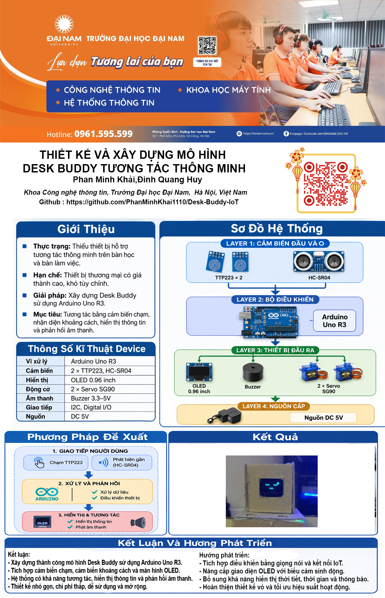
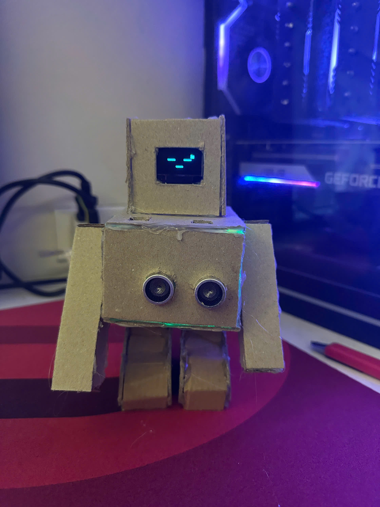
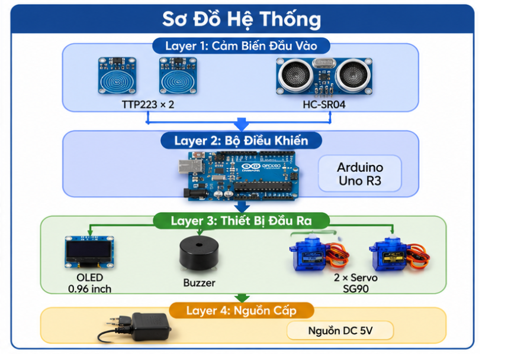
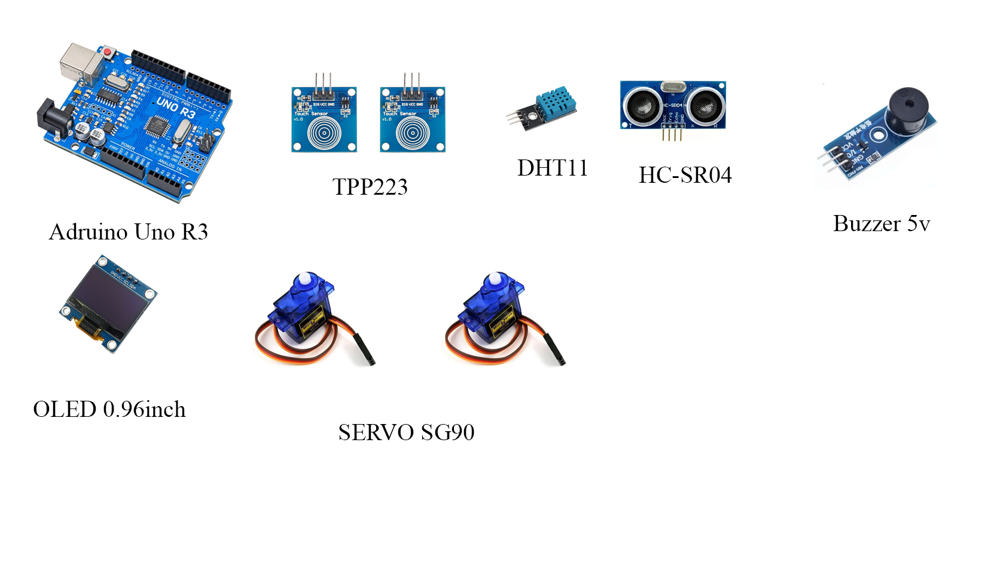

# DESK BUDDY IoT

**Desk Buddy** là dự án trợ lý để bàn thông minh sử dụng Arduino Uno R3, được thiết kế nhằm tạo ra một thiết bị tương tác nhỏ gọn thông qua cảm biến chạm, cảm biến khoảng cách, màn hình OLED và hệ thống phản hồi âm thanh.

## 1. Tổng quan dự án

Hệ thống được xây dựng dựa trên vi điều khiển Arduino Uno R3, tích hợp các linh kiện điện tử để tạo thành một trợ lý để bàn có khả năng nhận diện tương tác và phản hồi người dùng.

Các thành phần chính:

- Bộ điều khiển: Arduino Uno R3.
- Cảm biến đầu vào: 2 cảm biến chạm TTP223 và cảm biến khoảng cách HC-SR04.
- Hiển thị: Màn hình OLED 0.96 inch.
- Thiết bị đầu ra: Buzzer và 2 động cơ Servo SG90.

## 2. Chức năng chính

- Nhận diện thao tác chạm thông qua cảm biến TTP223.
- Phát hiện khoảng cách bằng cảm biến siêu âm HC-SR04.
- Hiển thị thông tin trên màn hình OLED.
- Phát âm thanh phản hồi thông qua Buzzer.
- Điều khiển chuyển động bằng hai Servo SG90.
- Tương tác trực tiếp với người dùng.

## 3. Công nghệ sử dụng

| Thành phần | Công nghệ |
|---|---|
| Vi điều khiển | Arduino Uno R3 |
| Ngôn ngữ lập trình | Arduino C/C++ |
| Cảm biến chạm | TTP223 × 2 |
| Cảm biến khoảng cách | HC-SR04 |
| Màn hình | OLED 0.96 inch |
| Động cơ | Servo SG90 × 2 |
| Âm thanh | Buzzer 3.3–5V |
| Giao tiếp | I2C, Digital I/O |
| Phần mềm | Arduino IDE |

## 4. Hình ảnh dự án

### 4.1. Poster

  

### 4.2. Mô hình Desk Buddy

  

### 4.3. Sơ đồ hệ thống

  

### 4.4. Các linh kiện sử dụng

  

## 5. Nguyên lý hoạt động

1. Cảm biến TTP223 nhận diện thao tác chạm của người dùng.
2. HC-SR04 đo khoảng cách và phát hiện vật thể phía trước.
3. Arduino Uno R3 tiếp nhận và xử lý tín hiệu từ các cảm biến.
4. Hệ thống điều khiển OLED, Buzzer và Servo để phản hồi tương ứng.
5. Trạng thái hoạt động được hiển thị trực quan trên màn hình.

## 6. Hướng phát triển

- Tích hợp điều khiển bằng giọng nói.
- Bổ sung kết nối WiFi và các tính năng IoT.
- Nâng cấp giao diện OLED với nhiều biểu cảm.
- Bổ sung chức năng hiển thị thời gian, thời tiết và thông báo.
- Cải tiến thiết kế vỏ để tăng tính thẩm mỹ và tiện dụng.

## 7. Thông tin dự án

- Sinh viên thực hiện: Phan Minh Khải
- Nền tảng: Arduino Uno R3
- Ngôn ngữ: Arduino C/C++
- Công cụ phát triển: Arduino IDE

---

**DESK BUDDY IoT – Your Smart Desktop Companion**
